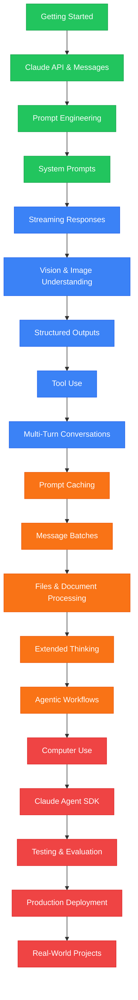

# Claude SDK Masterclass

> Venkata Bhattaram (c) 2026

An extensive, beginner-to-expert **Claude SDK Masterclass** with hands-on code examples — from installing the Anthropic Python SDK and making your first Claude API request, through messages, prompt engineering, streaming, vision, tool use, structured outputs, prompt caching, batch processing, agentic workflows, evaluation, testing, and production deployment.

## Learning Path

**Green = Beginner** &nbsp; | &nbsp; **Blue = Intermediate** &nbsp; | &nbsp; **Orange = Advanced** &nbsp; | &nbsp; **Red = Expert**

The Masterclass progressively moves from basic Claude API integration to advanced agentic systems and production-ready applications:

**Installation → Messages API → Prompt Engineering → Streaming → Vision → Structured Outputs → Tool Use → Conversations → Caching → Batch Processing → Extended Thinking → Agentic Workflows → Claude Agent SDK → Evaluation → Production**

## CONTENTS

### 01. Foundations

- [Introduction](./01-get-started/md/introduction.md)
- [Installation](./01-get-started/md/installation.md)

